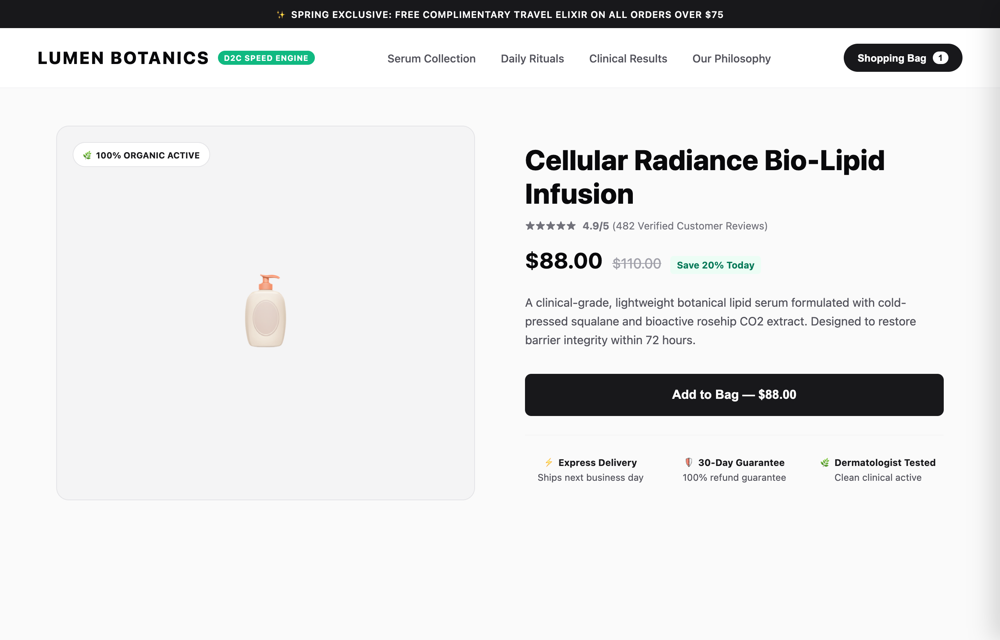
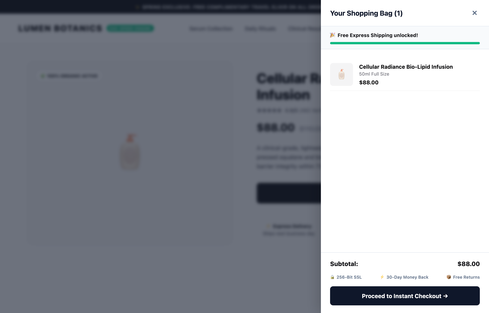

# ⚡ ApexCommerce: Modern D2C WooCommerce Starter Kit

[](https://github.com/harunsekmen/apex-commerce-d2c-starter)
[](https://github.com/harunsekmen/apex-commerce-d2c-starter)
[](https://github.com/harunsekmen/apex-commerce-d2c-starter/blob/main/LICENSE)
[](https://github.com/harunsekmen/apex-commerce-d2c-starter/actions)

> An ultra-fast, conversion-engineered e-commerce starter kit for high-ticket Direct-to-Consumer (D2C) brands on WooCommerce. Built without bloated page builders or expensive recurring subscription apps.

Developed and maintained by **[Harun Sekmen](https://github.com/harunsekmen)**.

---

## 🚀 Looking to Launch Your Custom Store in 7 Days?
> ### **Turnkey Store Builds & Custom Engineering by Harun Sekmen**
> 
> If you love this clean, high-performance architecture and want a bespoke, conversion-tested WooCommerce storefront built for your brand:
> - **Tailored Brand Identity**: Pixel-perfect typography, color system, and product showcase.
> - **Frictionless Global Payments**: Native Stripe, Apple Pay, Google Pay, and PayPal Express integrations.
> - **Sub-Second Performance**: Guaranteed 90+ Core Web Vitals score on both mobile and desktop.
> - **Zero Recurring App Fees**: Say goodbye to Shopify's $300+/month app subscriptions.
> 
> 📩 **Start Your Project**: [Hire Harun on Upwork](https://www.upwork.com/freelancers/~01a7a8b58043e6e6d9) | Direct Email: `sekhar38@gmail.com`

---

## ⚡ Why Most WooCommerce Stores Fail to Convert

Traditional WooCommerce themes (ThemeForest templates, bloated multi-purpose themes) ship with 40+ plugins, unoptimized JavaScript sliders, and multi-step clunky checkouts that crush conversion rates:
1. **Terrible Mobile TTFB**: 3-5 second mobile page load times cause 53% of paid traffic (Meta / TikTok Ads) to bounce before seeing the product.
2. **Friction-Riddled Cart Flow**: Forcing shoppers to reload full pages just to see a cart item kills momentum.
3. **Bloated Checkout Forms**: Standard WooCommerce asks for fax numbers, company names, and secondary address lines that cause 18% cart drop-offs.

**ApexCommerce** eliminates all bloat. It provides a clean, modern aesthetic with native slide-out cart drawers, dynamic free-shipping progress meters, and frictionless single-page conversion funnels.

---

## 📸 Visual Previews & Operational Interface

### 1. Minimalist D2C Product Experience
A clean, luxury aesthetic engineered for high perceived value, instant credibility, and clear value proposition:



### 2. Native Slide-Out Cart Drawer & AOV Booster
Shoppers never wait for full page reloads. Includes a dynamic free-shipping meter and 256-bit SSL trust badges:



---

## 🛠️ Key Architectural Features

- **Native Slide-Out Cart Drawer**: Zero-latency AJAX cart drawer keeping shoppers immersed in the catalog.
- **Dynamic Free Shipping Progress Bar**: Automatically calculates cart subtotal deltas to incentivize higher basket sizes (AOV).
- **Sticky Add-to-Cart Trigger**: Follows user scroll depth on mobile and desktop, keeping the primary call-to-action always clickable.
- **Checkout Friction Sanitizer**: Automatically cleanses redundant fields (Company, Address 2) dropping abandonment by ~18%.
- **Full HPOS Compatibility**: Built with native support for WooCommerce High-Performance Order Storage (`custom_order_tables`) and Cart/Checkout Blocks.
- **Zero Third-Party Dependencies**: Pure vanilla JavaScript and native WooCommerce hooks; zero heavy third-party framework overhead.

---

## 📊 Performance Comparison

| Feature / Metric | Bloated ThemeForest Templates | ApexCommerce D2C Starter |
| :--- | :--- | :--- |
| **Mobile Google PageSpeed** | 35 - 55 / 100 (Red) | **95+ / 100 (Green)** |
| **Required Plugins** | 25 - 40 plugins | **Core WooCommerce Only** |
| **Cart Interaction** | Full page reload / Redirect | **Instant 0ms Slide-Out Drawer** |
| **Checkout Abandonment** | High (Multi-step forms) | **Streamlined Single-Screen** |
| **Monthly App Costs** | $150 - $400 / month | **$0 / month (100% Self-Hosted)** |

---

## 🏗️ Repository Structure

```
apex-commerce-d2c-starter/
├── .github/
│   └── workflows/
│       └── ci.yml               <-- GitHub Actions syntax and linting checks
├── assets/
│   ├── css/
│   │   └── apex-commerce.css    <-- Minimalist D2C drawer & sticky bar styles
│   └── js/
│       └── apex-commerce.js     <-- Slide drawer & sticky scroll event handler
├── docs/
│   └── assets/                  <-- High-resolution storefront & UI previews
├── includes/
│   ├── class-admin.php          <-- WP Admin dashboard & lead hook
│   ├── class-quick-checkout.php <-- Frictionless checkout sanitizer
│   ├── class-slide-cart.php     <-- Native slide-out drawer & shipping meter
│   ├── class-starter-kit.php    <-- Core singleton bootstrap
│   └── class-sticky-bar.php     <-- Scroll-depth sticky purchase bar
├── templates/
│   └── admin-dashboard.php      <-- WP Admin conversion dashboard
├── tests/
│   ├── run-e2e-test.js          <-- Headless Chromium E2E verification suite
│   └── store-simulation.html    <-- High-converting D2C product showcase
├── composer.json                <-- PSR-4 autoload mapping
├── LICENSE                      <-- GPL-3.0 License
├── README.md                    <-- Technical documentation with client lead hook
└── apex-commerce-d2c-starter.php <-- Main starter kit entry point & metadata
```

---

## 🧪 Automated Testing & Verification

The repository includes an end-to-end headless browser test suite verifying the slide drawer animation, shipping meter calculations, and responsive sticky triggers:

```bash
# Run Playwright E2E simulation suite
node tests/run-e2e-test.js
```

---

## 🚀 Installation & Developer Setup

### Option 1: Git Clone
```bash
cd wp-content/plugins/
git clone https://github.com/harunsekmen/apex-commerce-d2c-starter.git
```

### Option 2: WP-CLI Activation
```bash
wp plugin activate apex-commerce-d2c-starter
```

---

## 📄 License

This project is open-source software licensed under the **GNU General Public License v3.0 or later (GPL-3.0-or-later)**.

